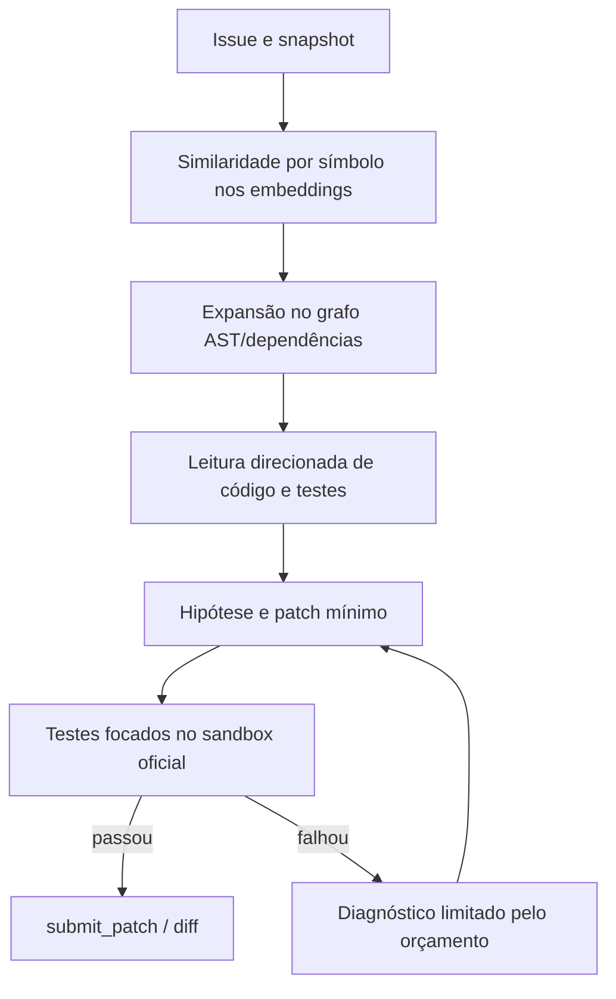

# Gemma 4 Autonomous Software Engineering Agent

Agente de engenharia de software baseado em Gemma 4, construído para a competição Kaggle **Google – The Gemma 4 Developer Agent Competition**: dado o relato de um bug em um repositório Python, o agente localiza o código relevante, propõe um patch mínimo e o valida com testes.

[](pyproject.toml)
[](LICENSE)
[](https://www.kaggle.com/competitions/gemma-4-developer-agent)

> **Estado honesto do projeto:** este repositório é um *scaffold* executável e testado localmente (auditoria de dados, preparação de exemplos SFT, métricas e empacotamento seguro). **Nenhum fine-tuning, benchmark oficial ou submissão Kaggle foi executado nesta cópia.** Não há pesos LoRA nem resultados preenchidos. Onde não há medição, o texto diz "não medido".

---

## 1. Problema de negócio

Manter software consome tempo de engenharia em triagem de issues, navegação em repositórios grandes, reprodução de falhas e escrita de correções. Os agentes de código mais capazes de hoje dependem de modelos enormes na nuvem, o que deixa essa automação fora do alcance de quem precisa trabalhar offline, em hardware comum ou com restrições de custo e privacidade.

A pergunta que este projeto investiga: **um agente local, com orçamento de tempo limitado, consegue resolver issues reais de Python de forma confiável, mantendo a revisão humana no final?**

## 2. Contexto

- **Benchmark:** a competição avalia correções de bugs em repositórios Python reais, no estilo SWE-Bench. Cada patch é aplicado ao repositório e os testes de validação são executados: o resultado é `PASS` ou `FAIL`.
- **Dados públicos de desenvolvimento:** 129 tarefas de quatro repositórios (FastAPI, Rich, Requests e HTTPX), com snapshots, grafos de chamadas/dependências (AST) e embeddings de código.
- **Ferramentas do harness:** `run_command`, `read_file`, `edit_file`, `write_file`, `submit_patch`, `get_status` e três ferramentas de grafo (`get_code_neighbors`, `search_similar_code`, `get_code_subgraph`).
- **Restrições:** sem internet no sandbox (Docker com 4 GiB de RAM e 2 vCPUs), um único modelo Gemma 4 por submissão, adaptadores LoRA opcionais, janela de contexto de 32.768 tokens e limite global de 12 horas para todas as tarefas.
- **Fonte técnica:** o `HARNESS_README.md` oficial (harness `swegemma`), que descreve o ciclo de avaliação em dois contêineres, as ferramentas, os orçamentos e o critério de aprovação.
- **Prazo final da competição:** 02/12/2026, 23:59 UTC. As regras e o `HARNESS_README.md` oficiais prevalecem sobre qualquer informação deste repositório.

## 3. Objetivo do projeto

Criei este projeto para:

1. entender, com dados, como combinar **busca semântica**, **navegação em grafo de código** e **testes focados** em um agente pequeno;
2. montar uma base **reprodutível e auditável** (dados, métricas e empacotamento) em vez de um script isolado;
3. documentar decisões e limites com honestidade, para que qualquer resultado futuro possa ser conferido.

## 4. Premissas

- Usar apenas o conjunto público de desenvolvimento, conforme as regras; nunca publicar dados da competição nem treinar com exemplos ocultos.
- `patch` e `test_patch` são alvos de treino e avaliação local. **O patch de referência nunca entra na entrada do agente durante a avaliação.**
- O objetivo é passar nos testes oficiais; similaridade com o patch de referência não é métrica.
- Grafos e embeddings podem ser incompletos: o código-fonte e os testes são a verdade final.
- `configs/agent.yaml` e `submission/agent.yaml` são pontos de partida, não configurações certificadas. Ao cruzá-los com o `HARNESS_README.md`, apareceram divergências (ver [Pendências](#14-limitações-e-próximos-passos)); tudo deve ser conferido com o `sample_submission/` oficial.
- Qualquer afirmação de ganho de qualidade, tempo ou custo exige medição repetível. Por isso, **não há alegações de ROI**.

## 5. Baseline

| Campo | Valor |
| --- | --- |
| Baseline de referência | Agente do `sample_submission/` oficial, sem LoRA |
| Taxa de aprovação do baseline | Não medido |
| Tempo médio por tarefa | Não medido |
| Hardware/runtime | Não medido |

O protocolo completo está em [`docs/experiments/baseline.md`](docs/experiments/baseline.md). Qualquer variante (prompt, grafo, LoRA, subagente) precisa superar este baseline nas mesmas tarefas, com o mesmo orçamento.

## 6. Estratégia da solução

O agente segue um funil com orçamento controlado:



1. Extrair comportamento, mensagens de erro e nomes de API da issue.
2. Buscar símbolos parecidos com `search_similar_code`, passando um **nome de símbolo** (ex.: `Class.method`) e não texto livre: no sandbox offline a ferramenta resolve o nome no grafo e calcula similaridade entre os embeddings já existentes (com fallback lexical para várias palavras).
3. Expandir apenas poucos símbolos relevantes no grafo; nunca despejar o grafo inteiro.
4. Confirmar no código-fonte (incluindo chamadores e testes próximos).
5. Editar o mínimo necessário, rodar o menor teste relevante (scripts de reprodução em `/tmp`, nunca em `/workspace`) e só então chamar `submit_patch`. Sem correção segura, o agente retorna `NO_PATCH`.

Detalhes em [`docs/architecture/`](docs/architecture/).

### Regras do harness que moldam o desenho

Resumo do `HARNESS_README.md` oficial (descrição do harness; nada disto foi executado localmente):

| Tema | Regra |
| --- | --- |
| Hardware de avaliação | 4× NVIDIA L4 (96 GB), vLLM com `max_model_len=32768`; prompt + raciocínio + saída cabem em 32.768 tokens, com compactação automática de contexto |
| Orçamento por tarefa | Padrão do `inference.py`: 60 min, 100 chamadas de ferramenta, 500 turnos; ajustável em `eval_config.yaml`. O sample oficial usa 1 min, 10 chamadas e 50 turnos |
| Ferramentas gratuitas | `submit_patch` e `get_status` não consomem o orçamento de chamadas |
| Limites do sandbox | Sem rede; comando até 300 s; saída até 5.000 caracteres; `read_file` até 150 linhas / 10.000 caracteres |
| Encerramento | `submit_patch` encerra o laço. Sem chamá-lo, o harness recupera o diff do `/workspace`; até 3 "nudges" de continuação |
| Extração do patch | `git add -N .` + `git diff`; hunks em testes e arquivos de configuração (`conftest.py`, `pytest.ini`, `pyproject.toml`...) são **removidos** |
| Critério de aprovação | `pytest` com código 0 e JUnit XML válido, com todos os testes exigidos passando (sem *skip*); nota = tarefas resolvidas / total |
| Submissão | Menos de 3 GiB; um único modelo; YAML declarativo; adaptadores `.safetensors` com rank ≤ 128; só extensões `.yaml .yml .md .txt .py .json .safetensors` |

## 7. Decisões técnicas

| Decisão | Motivo | Trade-off aceito |
| --- | --- | --- |
| Modelo `gemma-4-31b-it-qat-w4a16-ct` como ponto de partida | Maior capacidade entre as variantes suportadas e melhor nota pública entre os modelos listados na competição | Exige mais memória; E4B/E2B ficam como alternativas de menor custo |
| Temperatura baixa (0,1) | Reduz variabilidade entre execuções | Menos exploração de alternativas |
| `max_output_tokens` 16384 e `thinking_budget` 4096 (`submission/configs/sampling.yaml`) | Seguem a recomendação do guia contra o corte de chamadas `<\|tool_call>` | Menos contexto livre nos 32.768 tokens; ainda não medido |
| Limites por tarefa: 15 min, 60 chamadas, 120 turnos, 300 s por comando (`submission/eval_config.yaml`) | Dar espaço para depurar tarefas difíceis sem usar os padrões do harness | Precisa caber nas 12 h globais (ver Pendências); valores ainda não calibrados |
| Grafo e embeddings como "pistas", não verdade | Podem falhar em comportamento dinâmico | Exige leitura do código antes de editar |
| Patch mínimo e teste focado | Economiza o orçamento global de 12 h | Um teste estreito verde não garante a suíte oficial |
| Preparar SFT só com pares públicos issue/patch | Respeita as regras e evita raciocínio inventado | Dados limitados, sem trajetórias do agente |
| Empacotador que rejeita symlinks e caminhos fora da raiz | Segurança e conformidade com o sandbox | Não valida a semântica ADK nem a aceitação no Kaggle |

## 8. Tecnologias utilizadas

- **Python 3.13/3.14** com `pyyaml`, `numpy` e `networkx`
- **Google ADK Agent Config** (YAML) para declarar agente, subagente e skill
- **PEFT / Transformers / PyTorch** (opcional, grupo `training`) para LoRA
- **pytest** e **Ruff** para testes e lint, executados em **GitHub Actions** (Python 3.13 e 3.14)

## 9. Estrutura do repositório

```text
configs/             configurações de agente, amostragem e avaliação
docs/                arquitetura, decisões, experimentos e protocolo
experiments/         manifestos, sem pesos nem dados
papers/              rascunho de relatório e bibliografia
prompts/             instruções do agente e do analista
skills/              skill de navegação (repo_navigation)
sub_agents/          subagente opcional de localização de código
submission/          candidato a pacote da competição
src/gemma4_agent/    auditoria, dados SFT, métricas, treino e empacotamento
tests/               testes unitários locais
benchmarks/          protocolo e relatórios próprios
```

## 10. Como executar

**Pré-requisitos:** Python 3.13 ou 3.14 (ambos na matriz do CI; o desenvolvimento local usa 3.14.7). O sandbox da competição roda Python 3.13 dentro do Docker, independente do Python da sua máquina, e não é substituído pelo ambiente local. Para o grupo `training`, instale também um PyTorch compatível com sua CUDA e GPU; o projeto não escolhe nem baixa um build automaticamente.

```powershell
py -3.13 -m venv .venv
.\.venv\Scripts\Activate.ps1
python -m pip install --upgrade pip
python -m pip install -e ".[dev]"
python -m gemma4_agent --help
```

Mantenha o dataset em `data/competition/` (ignorado pelo Git).

### Auditar o dataset

```powershell
python -m gemma4_agent audit --tasks data/competition/tasks.jsonl `
  --graphs data/competition/graphs --embeddings data/competition/embeddings `
  --output benchmarks/reports/eda.json
```

O relatório traz apenas contagens e estatísticas; não exporta patches nem enunciados.

### Preparar exemplos supervisionados

```powershell
python -m gemma4_agent prepare-sft --tasks data/competition/tasks.jsonl `
  --output build/sft_train.jsonl --split train --seed 17
```

Gera pares issue/patch públicos. Não cria raciocínio fictício nem demonstra ganho do SFT. Revise licenças, formato conversacional e separação dos dados antes de treinar.

### Treinar um adaptador LoRA (opcional)

Com PyTorch/CUDA instalado e o checkpoint já disponível localmente:

```powershell
python -m gemma4_agent.training.train_lora --data build/sft_train.jsonl `
  --model "C:\modelos\gemma4" --output adapters/main_lora
```

O script grava um adaptador **candidato**. Nomes de módulos LoRA, compatibilidade com QAT e memória necessária precisam ser validados no checkpoint exato; este projeto não afirma que o script já rodou com Gemma 4. Ao montar a submissão, copie para `submission/adapters/<nome>/` **somente** `adapter_config.json` e `adapter_model.safetensors`: checkpoints e arquivos de tokenizador gravados na mesma pasta podem violar as extensões permitidas.

### Avaliar localmente com o harness oficial

O baseline deve ser medido com o harness da competição, fornecido junto ao dataset (exemplo do `HARNESS_README.md`, ainda não executado aqui):

```bash
swegemma eval --tasks tasks.jsonl --snapshots-dir snapshots \
  --submission-dir submission --results-dir results/run_01 \
  --sandbox docker --max-tool-calls 50 --max-time-minutes 30 --concurrency 2
```

Cada execução grava `summary.json` (taxa de resolução e detalhe por repositório), `task_results.jsonl`, `patches/`, `test_outputs/` e `traces/`. Use `--task-id` para depurar uma tarefa e mantenha o mesmo conjunto e os mesmos limites entre variantes.

### Testar, agregar resultados e empacotar

```powershell
python -m pytest
python -m gemma4_agent score --predictions caminho/predictions.jsonl --output benchmarks/reports/score.json
python -m gemma4_agent package --source submission --output build/submission.zip
```

O empacotador exige `agent.yaml` na raiz, valida os `!include` e rejeita symlinks, credenciais e caminhos fora da raiz. A validação final ainda depende do harness oficial.

## 11. Insights

**Ainda não há insights de desempenho do agente**, pois nenhum experimento foi executado. O que já se sabe, a partir de fontes externas e do desenho do projeto:

- O ranking público da competição estava muito comprimido (topo em torno de 0,24 em 25/11/2026, calculado sobre cerca de 50% do teste), o que sugere alta variância entre execuções. Por isso, o projeto exige comparações pareadas nas mesmas tarefas.
- Os testes locais cobrem a auditoria (sem vazar texto de issues ou patches), as métricas (sem inventar nota sem resultado do avaliador) e o empacotamento (caminhos seguros e credenciais).
- Aritmética de orçamento (estimativa, não medição): o conjunto de teste tem cerca de 120 tarefas e o limite global é de 12 h, o que dá em média ~6 min por tarefa se a execução fosse sequencial. A concorrência real do avaliador não é documentada, e o sample oficial usa orçamentos bem curtos (1 min, 10 chamadas).

Experimentos planejados (todos "não executados"): [`baseline`](docs/experiments/baseline.md), [`ablação de prompt`](docs/experiments/prompt-ablation.md), [`ablação de LoRA`](docs/experiments/lora-ablation.md) e [`taxonomia de falhas`](docs/experiments/failure-taxonomy.md).

## 12. Resultados e impacto

| Indicador | Resultado |
| --- | --- |
| Taxa de aprovação (`PASS / avaliadas`) no harness oficial | Não medido |
| Tempo, timeouts e falhas por repositório | Não medido |
| Ganho de LoRA vs. sem adaptador | Não medido |
| Impacto financeiro (R$) | Não estimado: exige tempo humano, custo de GPU, revisão e regressões medidos |

O indicador primário é a taxa de tarefas aprovadas; as demais são métricas secundárias. Os resultados só serão publicados quando reproduzidos, com fórmula, fontes e incerteza declaradas.

## 13. Aprendizados

- Em benchmarks com muita variância, **rigor de protocolo** (mesmas tarefas, mesmo orçamento, uma mudança por ablação) vale mais que uma nota isolada.
- Documentar o que **não** foi feito evita alegações que não resistem a uma auditoria.
- Separar rigorosamente dados de treino, avaliação e conteúdo restrito da competição precisa estar no código (testes e `.gitignore`), não só na documentação.
- O que faria diferente: começar pelo baseline oficial antes de qualquer LoRA.

## 14. Limitações e próximos passos

1. Revisar `HARNESS_README.md`, `sample_submission/` e as regras atuais no Kaggle.
2. Concluir a verificação de identidade e validar a submissão no formato oficial.
3. Executar EDA e baseline no conjunto público autorizado.
4. Corrigir as pendências abaixo e validar a integração ADK (incluindo o subagente opcional, ligado como `agent_tool`) contra o sample oficial.
5. Treinar LoRA somente após provar a qualidade dos exemplos e fixar o baseline.
6. Rodar as ablações e a avaliação completa; publicar apenas resultados reproduzidos.
7. Transformar os resultados em relatório ([`papers/paper_v1.md`](papers/paper_v1.md), hoje apenas um esboço).

**Pendências** (resolvidas desde a primeira leitura do `HARNESS_README.md`: formato do `eval_config.yaml`, lista de `tools`, orçamento de saída e raciocínio, consulta por nome de símbolo, scripts em `/tmp` e proteção de testes e configurações). Restam:

| Pendência | Ação |
| --- | --- |
| `max_time_minutes: 15` por tarefa × ~120 tarefas excede 12 h se a execução for sequencial (a concorrência do avaliador não é documentada) | Medir o tempo real por tarefa com `swegemma eval` e calibrar o orçamento |
| `submission/adapters/.gitkeep` pode entrar no ZIP e a extensão não consta na lista permitida; o `train_lora.py` grava checkpoints e tokenizador na pasta do adaptador | Excluir do ZIP, aplicar a lista de extensões no empacotador e copiar só `adapter_config.json` e `adapter_model.safetensors` |
| Nome da skill com underscore (`repo_navigation`); o padrão das skills ADK costuma usar hífen | Conferir no `sample_submission/` |
| Árvores duplicadas (raiz e `submission/`) podem divergir; só `submission/` é empacotada | Manter `submission/` como fonte única e remover ou sincronizar as cópias |
| SFT com pares issue→patch não ensina o uso de ferramentas em vários turnos exigido pelo harness | Medir contra o baseline antes de promover o LoRA |

## 15. Licença e dados

O código original está sob **Apache-2.0** (ver [`LICENSE`](LICENSE)). Isso não relicencia dados, pesos ou componentes de terceiros. Não adicione ao Git snapshots, grafos, embeddings, wheels, patches, chaves ou credenciais. Consulte as regras da competição antes de compartilhar qualquer artefato ([`docs/data-policy.md`](docs/data-policy.md)).

---

**Autor:** Sérgio Santos — Cientista de Dados | Ambientes Críticos e Governança de Dados

[](https://portfoliosantossergio.vercel.app)
[](https://linkedin.com/in/santossergioluiz)
