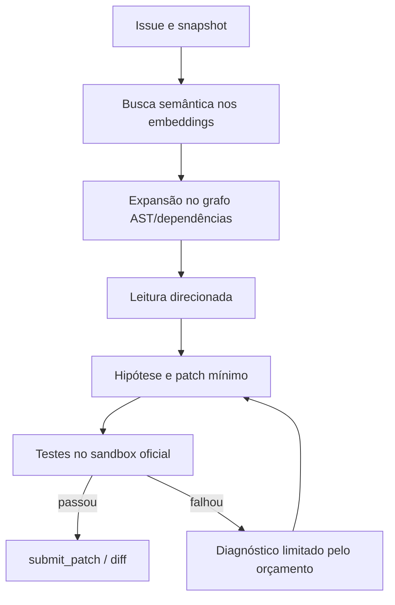

# Gemma 4 Autonomous Software Engineering Agent

Projeto de pesquisa e engenharia para avaliar um agente de correção de issues Python com o harness da competição Kaggle **Google – The Gemma 4 Developer Agent Competition**.

Repositório pretendido: [Santosdevbjj/gemma4-autonomous-software-engineering-agent](https://github.com/Santosdevbjj/gemma4-autonomous-software-engineering-agent).

> **Estado honesto:** esta entrega é um scaffold executável para auditoria de dados públicos, preparação de exemplos SFT, métricas e empacotamento seguro. Nenhum fine-tuning, benchmark oficial ou submissão Kaggle foi executado nesta cópia. Não há pesos LoRA nem resultados preenchidos. Esses resultados dependem do dataset oficial, do harness e de GPU.

## Problema e objetivo

Issues em repositórios grandes exigem localizar código relevante, entender dependências, fazer uma alteração pequena e verificar regressões. Modelos locais podem reduzir dependência de APIs remotas, mas precisam de ferramentas, limites de execução e avaliação reprodutível. Este projeto organiza essa investigação em torno de recuperação semântica e estrutural, geração de patches e validação por testes.

O indicador primário é a taxa de tarefas aprovadas (`PASS / avaliadas`) no harness oficial. Tempo, timeouts e falhas por repositório são métricas secundárias. Não há alegações de ROI: isso exige medições e premissas de custo explícitas.

## Escopo e premissas

- Use o conjunto público de desenvolvimento apenas conforme as regras; não publique dados da competição nem use exemplos ocultos no treino.
- `patch` e `test_patch` são alvos de treino/avaliação local. Nunca inclua o patch de referência na entrada do agente durante avaliação.
- A avaliação oficial, os modelos aceitos e os limites atuais devem ser conferidos no Kaggle e no `HARNESS_README.md` antes de submeter.
- `configs/agent.yaml` é um ponto de partida, não uma configuração certificada pelo harness. Compare com `sample_submission/` oficial.
- Não há ganho de qualidade demonstrado até existirem relatórios gerados por experimentos repetíveis.

## Arquitetura



O harness fornece as ferramentas. O agente deve usar os nomes e assinaturas oficiais.

## Estrutura

```text
configs/             configurações de agente, amostragem e avaliação
docs/                arquitetura, decisões, experimentos e protocolo
experiments/         manifestos, sem pesos/dados
papers/              rascunho de relatório e bibliografia
prompts/             instruções do agente e analista
skills/              skill de navegação
src/gemma4_agent/    auditoria, dados SFT, métricas e empacotamento
tests/               testes unitários locais
benchmarks/          relatórios e resultados próprios
```

## Começar localmente

Requer Python 3.13 ou 3.14 para os utilitários. O runtime local não substitui a imagem do sandbox. Para `.[training]`, instale também uma versão de PyTorch compatível com a CUDA e a GPU disponíveis; o projeto não escolhe nem baixa um build de PyTorch automaticamente.

```powershell
py -3.13 -m venv .venv
.\.venv\Scripts\Activate.ps1
python -m pip install --upgrade pip
python -m pip install -e ".[dev]"
python -m gemma4_agent --help
```

Mantenha o dataset em `data/competition/` (ignorado pelo Git).

### Auditar o dataset

```powershell
python -m gemma4_agent audit --tasks data/competition/tasks.jsonl `
  --graphs data/competition/graphs --embeddings data/competition/embeddings `
  --output benchmarks/reports/eda.json
```

O relatório inclui contagens e estatísticas; não exporta patches nem enunciados integrais.

### Preparar exemplos supervisionados

```powershell
python -m gemma4_agent prepare-sft --tasks data/competition/tasks.jsonl `
  --output build/sft_train.jsonl --split train --seed 17
```

Isso prepara pares issue/patch públicos. Não cria raciocínio fictício nem demonstra ganho do SFT. Revise licenças, formato conversacional do modelo e separação dos dados antes de treinar.

Com PyTorch/CUDA instalado para a GPU disponível e o checkpoint já presente localmente, o ponto de partida de treino é:

```powershell
python -m gemma4_agent.training.train_lora --data build/sft_train.jsonl `
  --model "C:\modelos\gemma4" --output adapters/main_lora
```

O script grava um adaptador candidato. Os nomes de módulos LoRA, a compatibilidade QAT e a memória necessária precisam ser validados para o checkpoint exato; este projeto não afirma que o script já foi executado com Gemma 4.

### Testar e empacotar

```powershell
python -m pytest
python -m gemma4_agent package --source submission --output build/submission.zip
```

O empacotador rejeita symlinks e caminhos fora da raiz. A validação final ainda precisa do harness oficial.

## Baseline, avaliação e impacto

Registre um baseline sem LoRA e mantenha o mesmo conjunto, configuração e limites em cada ablação. Use `benchmarks/README.md` e `experiments/`. Agregue saídas `id`/`prediction` com `python -m gemma4_agent score`.

Não traduza taxa de aprovação em ROI sem medir tempo humano, custo de GPU, revisão e regressões. Declare fórmula, fontes e incerteza.

## Limitações e próximos passos

1. Revisar `HARNESS_README.md`, `sample_submission/` e regras atuais no Kaggle.
2. Executar EDA e baseline no conjunto público autorizado.
3. Validar a integração ADK contra o sample oficial.
4. Treinar LoRA somente após provar a qualidade dos exemplos e estabelecer baseline.
5. Rodar ablações e avaliação completa; publicar apenas resultados reproduzidos.

## Licença e dados

O código original deste repositório está sob Apache-2.0. Isso não relicencia dados, pesos ou componentes de terceiros. Não adicione snapshots, grafos, embeddings, wheels, patches, chaves ou credenciais ao Git. Consulte as regras antes de compartilhar artefatos.
